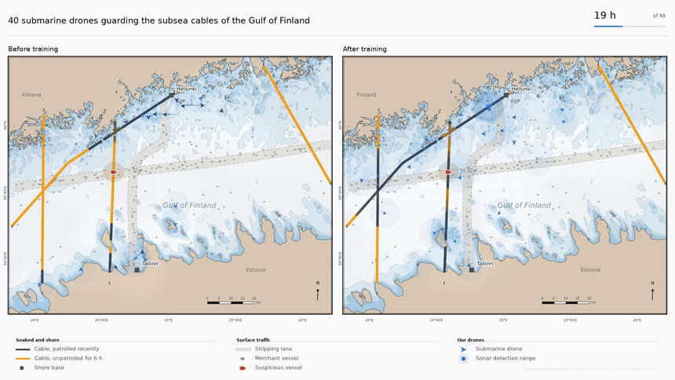
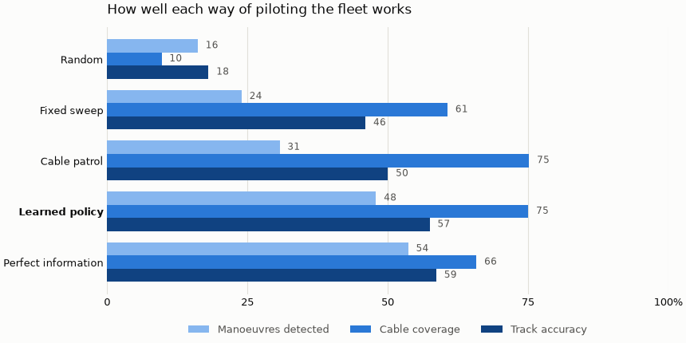

# Baltic Submarine ISR

A simulator for a fleet of autonomous underwater vehicles guarding the subsea
cables of the Gulf of Finland. Forty vehicles patrol the Helsinki–Tallinn
narrows listening for ships that stop where a shipping lane crosses a cable.
They have only passive sonar, going fast makes them deaf, and they can rarely
talk to each other. The fleet learns how to share the water by reinforcement
learning. The sea floor is surveyed data; **everything that moves is
synthetic.**



Left, the decision network before training; right, the same network after.
Same sea, same traffic, same clock. The untrained fleet bunches into clumps
and leaves most cables amber — unheard for six hours. The trained one spreads
along the cable network and keeps them dark.



Five ways of deciding where to go, on the same seeds. The oracle sees the
whole truth and is there as a ceiling, not a competitor: the learned policy
gets within six points of it while each vehicle decides alone, from sonar and
a modem that reaches a few kilometres.

---

## The three regimes

Everything hard about the problem is in this table. Ranges are solved on a
passive sonar equation, not configured; `baltic-isr budget` regenerates them.

| | speed | hears | draws | lasts | modem |
|---|---|---|---|---|---|
| **drift** | 0 m/s | 6.98 km | 15 W | 14.4 days | 100 % |
| **cruise** | 1.2 m/s | 5.95 km | 110 W | 47.3 h | 53 % |
| **sprint** | 2.5 m/s | **2.20 km** | 874 W | **5.9 h** | **6 %** |

Between drifting and cruising the ear barely suffers. Between cruising and
sprinting it is cut by 2.7×, because at speed a vehicle hears its own flow
noise instead of the sea — and propulsion goes as the cube of speed, so the
battery falls off a cliff at the same moment. **A vehicle that races to a
rendezvous arrives deaf.**

A vehicle has nobody within modem range 73 % of the time, so information
mostly travels by being physically carried. That is why a contact is not
tracked but **released with a prediction** — where it will be, when, to
within how much — for another vehicle to verify later. A prediction fits in
74 bits; a full track does not, and 250 bytes is what an acoustic modem
passes.

## Results

Untrained network against the learned policy, four seeds × eight worlds.
More is better in every row.

| | before | after | |
|---|---|---|---|
| suspicious manoeuvres noticed | 7 % | **48 %** |
| cable picture kept fresh | 11 % | **75 %** |
| picture accuracy | 16 % | **57 %** |

Against the better scripted patrol it notices far more (48 % against 31 %)
and holds a more accurate picture (57 % against 50 %), while spending nearly
twice the sensor contact time doing it. It also learns never to sprint: 0 %
of decisions, against 23 % before training.

Nothing about this coordination is written down. Neither the spreading, nor
the refusal to sprint, nor the cable patrol is in the code — they follow from
a shared reward and a local observation.

---

## Installation

Python 3.12 and [uv](https://docs.astral.sh/uv/).

```bash
uv sync --system-certs --all-groups
```

`torch` from PyPI is CPU-only on Windows; `pyproject.toml` redirects it to the
PyTorch CUDA index. Trains on a single RTX 2060.

## Usage

```bash
uv run baltic-isr budget      # the sonar equation, resolved from config/
uv run baltic-isr scenarios   # the five scenarios and their ranges
uv run baltic-isr world       # 48 h of traffic across 64 gulfs
uv run baltic-isr fleet       # the sortie cycle, and what it costs
uv run baltic-isr replay      # one episode as a film
```

Reproducing the result, in order:

```bash
uv run python scripts/train_decentralised.py   # the policy
uv run python scripts/train_oracle.py          # the upper bound
uv run python scripts/architectures.py         # the comparison figure
uv run python scripts/films.py                 # measure, record, render
uv run python scripts/gif.py                   # the loop in this README
```

Do not run a render and a training at the same time: 6 GB of VRAM does not
hold both.

---

## Caveats

All data are synthetic. Depth and coastline come from the EMODnet
Bathymetry Consortium's Consolidated DTM for European sea regions, used under
CC-BY 4.0.
