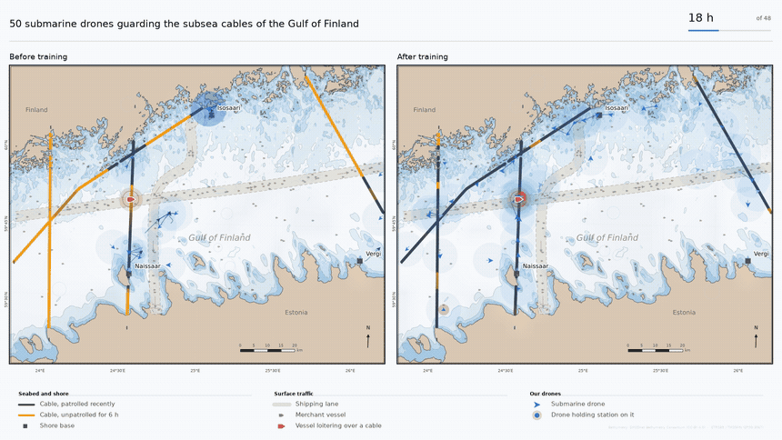
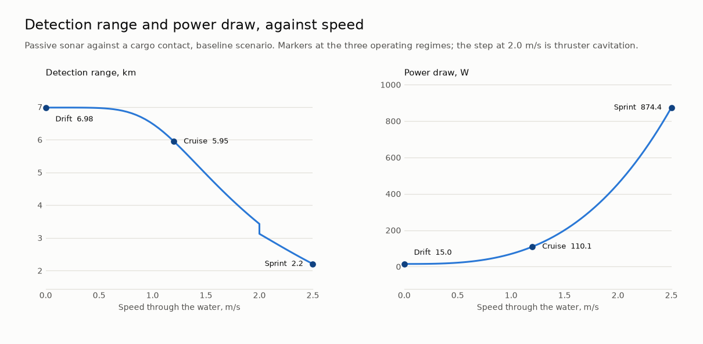

# Baltic Submarine ISR

A simulator for a fleet of autonomous underwater vehicles guarding the subsea
cables of the Gulf of Finland. Fifty vehicles patrol the Helsinki–Tallinn
narrows listening for ships that stop where a shipping lane crosses a cable.
They have only passive sonar, going fast makes them deaf, and they can rarely
talk to each other. The fleet learns how to share the water by **reinforcement
learning**. The sea floor is surveyed data, and everything that moves is
synthetic.

Interviewed in *Le Monde* on 31 October 2026,French admiral Cédric Chetaille 
described [a new undersea "star wars"][lemonde] being fought on
the ocean floor. Two of his remarks are the premises this simulator starts
from. Spotting a cable a few centimetres across down there, he says, is like
hunting for a garden hose across the whole Alpine range. And intent is nearly
unprovable: no Baltic cable-damage case had by then produced a conviction or a
clear attribution, because the crews involved invariably pleaded a navigation
error. I believe drones are part of the answer.

[lemonde]: https://www.lemonde.fr/international/article/2026/10/31/cedric-chetaille-contre-amiral-nous-assistons-a-une-forme-de-nouvelle-guerre-des-etoiles-sous-marine_6803715_3210.html



On the left, the decision network before training. On the right, the same
network after. Same sea, same traffic, same clock. The untrained fleet
bunches into clumps and leaves most cables amber, which means unheard for six
hours. The trained one spreads along the cable network and keeps them dark,
and when a vessel stops where it has no business stopping, the drones that
hear it converge on it and monitor.



The constraint everything else turns on. A drone holding still hears a ship
seven kilometres away, one hurrying hears it at two, having spent sixty times
the power to be there sooner. The cliff at 2 m/s is the propeller starting to
cavitate: 300 metres of hearing gone for the last sliver of speed.

---

## The three regimes

Everything hard about the problem is in this table. Ranges are solved on a
passive sonar equation rather than configured. Run `baltic-isr budget` to
regenerate them.

| | speed | hears | draws | lasts | modem |
|---|---|---|---|---|---|
| **drift** | 0 m/s | 6.98 km | 15 W | 14.4 days | 100 % |
| **cruise** | 1.2 m/s | 5.95 km | 110 W | 47.3 h | 53 % |
| **sprint** | 2.5 m/s | **2.20 km** | 874 W | **5.9 h** | **6 %** |

Between drifting and cruising the ear barely suffers. Between cruising and
sprinting it is cut by 2.7×, because at speed a vehicle hears its own flow
noise instead of the sea. Propulsion goes as the cube of speed, so the
battery falls off a cliff at the same moment. **A vehicle that races to a
rendezvous arrives deaf.**

A vehicle has nobody within modem range 35 % of the time, so information
mostly travels by being physically carried. That is why a contact is not
tracked but released with a prediction of where it will be, when, and to
within how much, for another vehicle to verify later. A prediction fits in
75 bits.

## Results

Untrained network against the learned policy, four seeds × eight worlds,
thirty-two episodes of forty-eight hours each.

| | before | after | |
|---|---|---|---|
| suspicious manoeuvres noticed | 45 % | **87 %** | 1.9× |
| cable picture kept fresh | 24 % | **84 %** | 3.5× |
| picture accuracy | 37 % | **58 %** | 1.6× |

Scripted patrols are the harder comparison, because a plan that already knows
where the cables are is a good plan. Against the better of them, the learned
fleet leaves a cable unheard for 3.9 hours against 11.2, and on the seeds the
two were scored against each other misses 9 % of manoeuvres against 18 %. It
also learns not to sprint, under 1 % of decisions against 23 % before
training, and to spend a quarter of its time drifting, the only regime in
which it hears properly.

Nothing about this coordination is written down. Neither the spreading, nor
the refusal to sprint, nor the cable patrol is in the code, they follow from
a shared reward and a local observation.

## The reward

Every vehicle gets its own reward and its own advantage. Nothing is summed
over the fleet, so the agents are selfish and every cooperative habit above
has to pay for itself at the individual level.

$$
\begin{aligned}
r_i \;=\;\; & 2.0\,V_i \;+\; 3.0\,A_i \;+\; 0.3\,E_i \;+\; 4.4\,C_i \;+\; 16.0\,S_i \\
            & -\; 1.0\,Q_i \;-\; 0.25\,P_i \;-\; 1.5\,T_i \;-\; 24.0\,U_i \;-\; 10.0\,L_i \\
            & +\; 10\,\Big(\gamma\,\Phi^{\,\text{cable}}_i(s') - \Phi^{\,\text{cable}}_i(s)\Big)
              \;+\; 10\,\Big(\gamma\,\Phi^{\,\text{suspect}}_i(s') - \Phi^{\,\text{suspect}}_i(s)\Big)
\end{aligned}
$$

The first line is what a vehicle earns, the second what it is charged, the
third the shaping. Everything is per vehicle $i$, with $\gamma = 0.95$.

| | symbol | weight | what it measures |
|---|---|---|---|
| escort | $S_i$ | 16.0 | time held on station near a vessel it judged suspicious |
| cable | $C_i$ | 4.4 | length of 3 km cable corridor covered, not just the line |
| alarm | $A_i$ | 3.0 | first alarm raised on a deviating vessel |
| verification | $V_i$ | 2.0 | how far it cut a contact's position uncertainty |
| exploration | $E_i$ | 0.3 | water swept that nobody had swept lately |
| crowding | $Q_i$ | 1.0 | standing beside a suspect without holding a slot |
| packing | $P_i$ | 0.25 | hulls past the fifth within 3 km, when not escorting |
| staleness | $T_i$ | 1.5 | share of its own tracks that have gone stale |
| energy | $U_i$ | 24.0 | fraction of the battery spent |
| loss | $L_i$ | 10.0 | running flat and being lost |

Two of those are **divided** among the vehicles that earned them in the same
step rather than paid to each in full: verification and cable cover. That one
line is what turns "coordination" from a slogan into arithmetic. Covering
what the others do not is worth more than doing the same work beside them.
Before it, 63 % of the fleet sat inside a neighbour's modem range.

`shaping` is potential-based, `k(γΦ(s′) − Φ(s))`, over two potentials. One is
the distance to the nearest unwatched cable, the other the distance to the
nearest suspect. Both carry k = 10 at γ = 0.95, and they exist to make a twelve
kilometre approach learnable at all. Potential-based shaping provably leaves
the optimal policy unchanged, which is worth knowing before reaching for it:
three attempts here to thin a crowd by capping the shaping failed for exactly
that reason, and the thing that worked was changing the credit instead.

### The network

One policy, shared by every vehicle and run on each vehicle's own
221-number observation. There is no fleet-wide state anywhere in the forward
pass. That is what "decentralised" has to mean once the modem is allowed to
fail. Two hidden layers of 256, separate actor and critic trunks, orthogonal
initialisation at √2, with the action head scaled to 0.01 so the policy
starts near uniform instead of unlearning an opinion it got from a random
number generator.

Twenty-five actions: eight headings × three regimes, plus a voluntary return
to base.

PPO, clip 0.2, γ 0.95, GAE λ 0.95, four epochs over eight minibatches,
entropy bonus 0.01, Adam at 3e-4, gradients clipped to 0.5. A rollout is 32
decisions across 32 parallel gulfs, so one update sees 51 200 transitions.

---

## Installation

Python 3.12 and [uv](https://docs.astral.sh/uv/).

```bash
uv sync --system-certs --all-groups
```

`torch` from PyPI is CPU-only on Windows, so `pyproject.toml` redirects it to
the PyTorch CUDA index. Trains on my single RTX 2060.

## Usage

```bash
uv run baltic-isr budget      # the sonar equation, resolved from config/
uv run baltic-isr scenarios   # the five scenarios and their ranges
uv run baltic-isr world       # 48 h of traffic across 64 gulfs
uv run baltic-isr fleet       # the sortie cycle, and what it costs
uv run baltic-isr replay      # one episode as a film
```

Reproducing the result, in order:

```bash
uv run python scripts/train_decentralised.py   # the policy
uv run python scripts/films.py                 # measure, record, render
uv run python scripts/explain.py               # the six figures
uv run python scripts/gif.py                   # the loop in this README
```

---

## Notes

All data are synthetic. Depth and coastline come from the EMODnet
Bathymetry Consortium's Consolidated DTM for European sea regions, used under
CC-BY 4.0.
